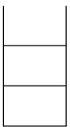
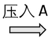
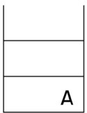
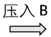
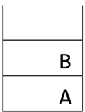
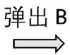
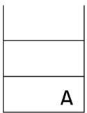
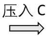
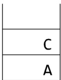

<!--page:1 printed:10-->

# 2020 CCF 非专业级别软件能力认证第一轮

<!--page:1 printed:10-->

# (CSP-J) 入门级 C++语言试题

认证时间:2020年10月11日14:30\~16:30

<!--page:1 printed:10-->

## 考生注意事项:

- 试题纸共有10页，答题纸共有1页，满分100分。请在答题纸上作答，写在试题纸上的一律无效。

- 不得使用任何电子设备（如计算器、手机、电子词典等）或查阅任何书籍资料。

<!--page:1 printed:10-->

## 一、单项选择题（共 15 题，每题 2 分，共计 30 分；每题有且仅有一个正确选项）

1. 在内存储器中每个存储单元都被赋予一个唯一的序号，称为（ ）。
A. 下标    B. 地址    C. 序号    D. 编号

2. 编译器的主要功能是（ ）。
A. 将源程序翻译成机器指令代码
B. 将一种高级语言翻译成另一种高级语言
C. 将源程序重新组合
D. 将低级语言翻译成高级语言

3. 设 x=true, y=true, z=false, 以下逻辑运算表达式值为真的是 ( )。
A.  $(x \land y) \land z$ 
B.  $x \land (z \lor y) \land z$ 
C.  $(x \land y) \lor (z \lor x)$ 
D.  $(y \lor z) \land x \land z$

4. 现有一张分辨率为  $2048 \times 1024$  像素的 32 位真彩色图像。请问要存储这张图像，需要多大的存储空间？（）。 A. 4MB B. 8MB C. 32MB D. 16MB

5. 冒泡排序算法的伪代码如下:
输入: 数组 L, n ≥ 1。输出: 按非递减顺序排序的 L。
算法 BubbleSort:
    1. FLAG ← n //标记被交换的最后元素位置
    2. while FLAG > 1 do
    3. k ← FLAG -1
    4. FLAG ← 1
    5. for j = 1 to k do
    6. if L(j) > L(j+1) then do
    7. L(j) ↔ L(j+1)
    8. FLAG ← j

<!--page:2-->

对 n 个数用以上冒泡排序算法进行排序，最少需要比较多少次？（）。
A. n    B. n-2    C.  $n^{2}$    D. n-1

6. 设 A 是 n 个实数的数组，考虑下面的递归算法:
XYZ (A[1..n])
    if n=1 then return A[1]
    else temp ← XYZ (A[1..n-1])
        if temp < A[n]
            then return temp
        else return A[n]

请问算法 XYZ 的输出是什么？（）。A. A 数组的平均 B. A 数组的最小值 C. A 数组的最大值 D. A 数组的中值

7. 链表不具有的特点是（）。
A. 插入删除不需要移动元素
B. 可随机访问任一元素
C. 不必事先估计存储空间
D. 所需空间与线性表长度成正比

8. 有 10 个顶点的无向图至少应该有（）条边才能确保是一个连通图。
A. 10 B. 12 C. 9 D. 11

9. 二进制数 1011 转换成十进制数是（）。
A. 10 B. 13 C. 11 D. 12

10. 五个小朋友并排站成一列，其中有两个小朋友是双胞胎，如果要求这两个双胞胎必须相邻，则有（）种不同排列方法？
A. 24 B. 36 C. 72 D. 48

11. 下图中所使用的数据结构是（）。



A.







B.

二叉树





C. 栈







D. 队列

12. 独根树的高度为 1。具有 61 个结点的完全二叉树的高度为（）。
A. 7 B. 5 C. 8 D. 6

13. 干支纪年法是中国传统的纪年方法，由 10 个天干和 12 个地支组合成 60 个天干地支。由公历年份可以根据以下公式和表格换算出对应的天干地支。
天干=（公历年份）除以 10 所得余数
地支=（公历年份）除以 12 所得余数

<!--page:3-->

| 天干 | 甲 | 乙 | 丙 | 丁 | 戊 | 己 | 庚 | 辛 | 壬 | 癸 |  |  |
| --- | --- | --- | --- | --- | --- | --- | --- | --- | --- | --- | --- | --- |
|  | 4 | 5 | 6 | 7 | 8 | 9 | 0 | 1 | 2 | 3 |  |  |
| 地支 | 子 | 丑 | 寅 | 卯 | 辰 | 巳 | 午 | 未 | 申 | 酉 | 戌 | 亥 |
|  | 4 | 5 | 6 | 7 | 8 | 9 | 10 | 11 | 0 | 1 | 2 | 3 |

例如，今年是 2020 年，2020 除以 10 余数为 0，查表为“庚”；2020 除以 12，余数为 4，查表为“子”，所以今年是庚子年。

请问 1949 年的天干地支是（）
A. 己亥    B. 己丑    C. 己卯    D. 己酉

14. 10 个三好学生名额分配到 7 个班级，每个班级至少有一个名额，一共有（）种不同的分配方案。
A. 56 B. 84 C. 72 D. 504

15. 有五副不同颜色的手套（共 10 只手套，每副手套左右手各 1 只），一次性从中取 6 只手套，请问恰好能配成两副手套的不同取法有（）种。
A. 30 B. 150 C. 180 D. 120

<!--page:3-->

## 二、阅读程序（程序输入不超过数组或字符串定义的范围；判断题正确填√，错误填×；除特殊说明外，判断题1.5分，选择题3分，共计40分）

```
#include <cstdlib>
#include <iostream>
using namespace std;
char encoder[26] = {'C', 'S', 'P', 0};
char decoder[26];
string st;
int main() {
    int k = 0;
    for (int i = 0; i < 26; ++i)
        if (encoder[i] != 0) ++k;
    for (char x = 'A'; x <= 'Z'; ++x) {
        bool flag = true;
        for (int i = 0; i < 26; ++i)
            if (encoder[i] == x) {
                flag = false;
                break;
}
    if (flag) {
        encoder[k] = x;
        ++k;
    }
}
for (int i = 0; i < 26; ++i)
    decoder[encoder[i] - 'A'] = i + 'A';
cin >> st;
for (int i = 0; i < st.length(); ++i)
    st[i] = decoder[st[i] - 'A'];
cout << st;
return 0;
}
```

<!--page:4-->

- 判断题

1）输入的字符串应当只由大写字母组成，否则在访问数组时可能越界。（）

2）若输入的字符串不是空串，则输入的字符串与输出的字符串一定不一样。（）

3）将第12行的“i < 26”改为“i < 16”，程序运行结果不会改变。（）

4）将第26行的“i < 26”改为“i < 16”，程序运行结果不会改变。

<!--page:4-->

## - 单选题

5）若输出的字符串为“ABCABCABCA”，则下列说法正确的是（）。A. 输入的字符串中既有 A 又有 P
B. 输入的字符串中既有 S 又有 B
C. 输入的字符串中既有 S 又有 P
D. 输入的字符串中既有 A 又有 B

6）若输出的字符串为“CSPCSPCSPCSP”，则下列说法正确的是（）。A. 输入的字符串中既有 J 又有 R
B. 输入的字符串中既有 P 又有 K
C. 输入的字符串中既有 J 又有 K
D. 输入的字符串中既有 P 又有 R

2.

01 #include &lt;iostream&gt;

<!--page:5-->

```
using namespace std;
long long n, ans;
int k, len;
long long d[1000000];
int main() {
    cin >> n >> k;
    d[0] = 0;
    len = 1;
    ans = 0;
    for (long long i = 0; i < n; ++i) {
        ++d[0];
        for (int j = 0; j + 1 < len; ++j) {
            if (d[j] == k) {
                d[j] = 0;
                d[j + 1] += 1;
                ++ans;
            }
        }
        if (d[len - 1] == k) {
            d[len - 1] = 0;
            d[len] = 1;
            ++len;
            ++ans;
        }
    }
    cout << ans << endl;
    return 0;
}
```

假设输入的 n 是不超过  $2^{62}$  的正整数，k 都是不超过 10000 的正整数，完成下面的判断题和单选题:

<!--page:5-->

## - 判断题

1) 若 k=1，则输出 ans 时，len=n。（）

2）若 k>1，则输出 ans 时，len 一定小于 n。（）

3）若 k>1，则输出 ans 时， $k^{len}$  一定大于 n。（）

<!--page:5-->

## - 单选题

4）若输入的 n 等于  $10^{15}$ ，输入的 k 为 1，则输出等于（）。A.  $(10^{30}-10^{15})/2$  B.  $(10^{30}+10^{15})/2$  C. 1 D.  $10^{15}$

<!--page:6-->

5）若输入的 n 等于 205,891,132,094,649(即  $3^{30}$ )，输入的 k 为 3，则输出等于（）。A.  $(3^{30}-1)/2$  B.  $3^{30}$  C.  $3^{30}-1$  D.  $(3^{30}+1)/2$

6) 若输入的 n 等于 100,010,002,000,090，输入的 k 为 10，则输出等于（）。
A. 11,112,222,444,543
B. 11,122,222,444,453
C. 11,122,222,444,543
D. 11,112,222,444,453

```
#include <algorithm>
#include <iostream>
using namespace std;
int n;
int d[50][2];
int ans;
void dfs(int n, int sum) {
    if (n == 1) {
        ans = max(sum, ans);
        return;
    }
    for (int i = 1; i < n; ++i) {
        int a = d[i - 1][0], b = d[i - 1][1];
        int x = d[i][0], y = d[i][1];
        d[i - 1][0] = a + x;
        d[i - 1][1] = b + y;
        for (int j = i; j < n - 1; ++j)
            d[j][0] = d[j + 1][0], d[j][1] = d[j + 1][1];
        int s = a + x + abs(b - y);
        dfs(n - 1, sum + s);
        for (int j = n - 1; j > i; --j)
            d[j][0] = d[j - 1][0], d[j][1] = d[j - 1][1];
        d[i - 1][0] = a, d[i - 1][1] = b;
        d[i][0] = x, d[i][1] = y;
    }
}
int main() {
    cin >> n;
    for (int i = 0; i < n; ++i)
cin >> d[i][0];
    for (int i = 0; i < n; ++i)
        cin >> d[i][1];
    ans = 0;
    dfs(n, 0);
    cout << ans << endl;
    return 0;
}
```

<!--page:7-->

假设输入的 n 是不超过 50 的正整数，d[i][0]、d[i][1]都是不超过 10000 的正整数，完成下面的判断题和单选题:

- 判断题

1）若输入 n 为  $\theta$ ，此程序可能会死循环或发生运行错误。（）

2）若输入 n 为 20，接下来的输入全为 0，则输出为 0。（）

3）输出的数一定不小于输入的 d[i][θ] 和 d[i][1] 的任意一个。

<!--page:7-->

## - 单选题

4) 若输入的 n 为 20，接下来的输入是 20 个 9 和 20 个 0，则输出为（）。A. 1917 B. 1908 C. 1881 D. 1890

5) 若输入的 n 为 30，接下来的输入是 30 个 0 和 30 个 5，则输出为（）。
A. 2020 B. 2030 C. 2010 D. 2000

6) （4分）若输入的 n 为 15，接下来的输入是 15 到 1，以及 15 到 1，则输出为（）。
A. 2420 B. 2220 C. 2440 D. 2240

<!--page:7-->

## 三、完善程序（单选题，每小题3分，共计30分）

<!--page:7-->

## 1. （质因数分解）给出正整数 n，请输出将 n 质因数分解的结果，结果从小到大输出。

例如:输入 n=120，程序应该输出 2 2 2 3 5，表示  $120=2\times2\times2\times3\times5$ 。输入保证  $2 \leqslant n \leqslant 10^{9}$ 。提示:先从小到大枚举变量 i，然后用 i 不停试除 n 来寻找所有的质因子。

试补全程序。

#include &lt;cstdio&gt;
using namespace std;

<!--page:8-->

```
int n, i;
int main() {
    scanf("%d", &n);
    for(i = ①; ② <= n; i ++) {
        ③ {
            printf("%d ", i);
            n = n / i;
        }
    }
    if(④)
        printf("%d ", ⑤);
    return 0;
```

17 }

1) ①处应填（）
A. n - 1 B. 0 C. 1 D. 2

2）②处应填（）
A. n / i
B. n / (i \* i)
C. i \* i \* i
D. i \* i

3) ③处应填（）
A. if (i \* i <= n)
B. if (n % i == 0)
C. while (i \* i <= n)
D. while (n % i == 0)

4) ④处应填（）
A. n > 1
B. n <= 1
C. i + i <= n
D. i < n / i

5) ⑤处应填（）
A. 2 B. i C. n / i D. n

2. (最小区间覆盖)给出 n 个区间，第 i 个区间的左右端点是  $[a_{i}, b_{i}]$ 。现在要在这些区间中选出若干个，使得区间  $[\theta, m]$  被所选区间的并覆盖（即每一个  $\theta \leqslant i \leqslant m$  都在某个所选的区间中）。保证答案存在，求所选区间个数的最小值。

输入第一行包含两个整数 n 和 m ( $1 \leqslant n \leqslant 5000, 1 \leqslant m \leqslant 10^{9}$ )。

接下来 n 行，每行两个整数  $a_{i}$ ， $b_{i}$  ( $\theta \leqslant a_{i}$ ， $b_{i} \leqslant m$ )。

提示:使用贪心法解决这个问题。先用  $\theta(n^{2})$  的时间复杂度排序，然后贪心选择这些区间。

试补全程序。

<!--page:9-->

```
#include <iostream>
using namespace std;
const int MAXN = 5000;
int n, m;
struct segment { int a, b; } A[MAXN];
void sort() // 排序
{
    for (int i = 0; i < n; i++)
        for (int j = 1; j < n; j++)
            if (①)
            {
                segment t = A[j];
                ②
            }
}
int main()
{
    cin >> n >> m;
    for (int i = 0; i < n; i++)
        cin >> A[i].a >> A[i].b;
    sort();
    int p = 1;
    for (int i = 1; i < n; i++)
        if (③)
            A[p++] = A[i];
    n = p;
    int ans = 0, r = 0;
    int q = 0;
    while (r < m)
    {
        while (④)
            q++;
        ⑤;
        ans++;
    }
    cout << ans << endl;
    return 0;
}
```

<!--page:10-->


1) ①处应填（）
A. A[j].b < A[j - 1].b
B. A[j].b > A[j - 1].b
C. A[j].a < A[j - 1].a
D. A[j].a > A[j - 1].a

2) ②处应填（）
A. A[j - 1] = A[j]; A[j] = t;
B. A[j + 1] = A[j]; A[j] = t;
C. A[j] = A[j - 1]; A[j - 1] = t;
D. A[j] = A[j + 1]; A[j + 1] = t;

3) ③处应填（）
A. A[i].b < A[p - 1].b
B. A[i].b > A[i - 1].b
C. A[i].b > A[p - 1].b
D. A[i].b < A[i - 1].b

4) ④处应填（）
A. q + 1 < n && A[q + 1].b <= r
B. q + 1 < n && A[q + 1].a <= r
C. q < n && A[q].a <= r
D. q < n && A[q].b <= r

5) ⑤处应填（）
A. $r = \max(r, A[q + 1].a)$ 
B. $r = \max(r, A[q].b)$
C. $r = \max(r, A[q + 1].b)$ 
D. $q++$
